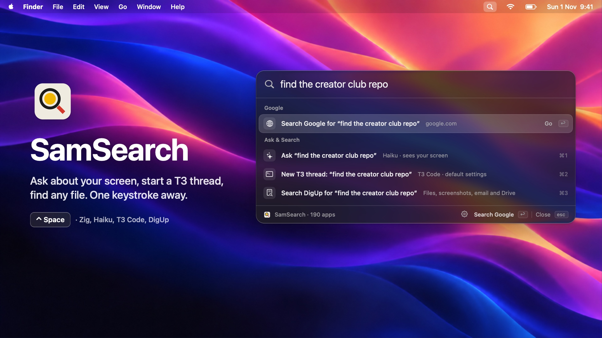
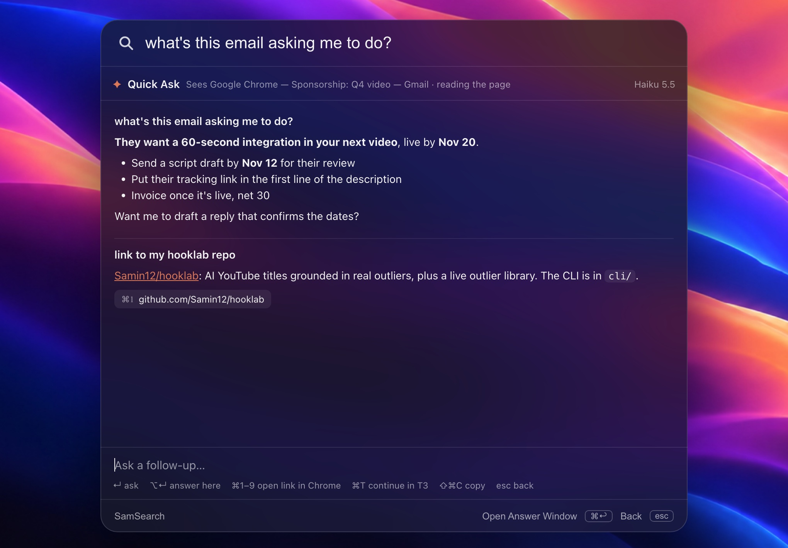
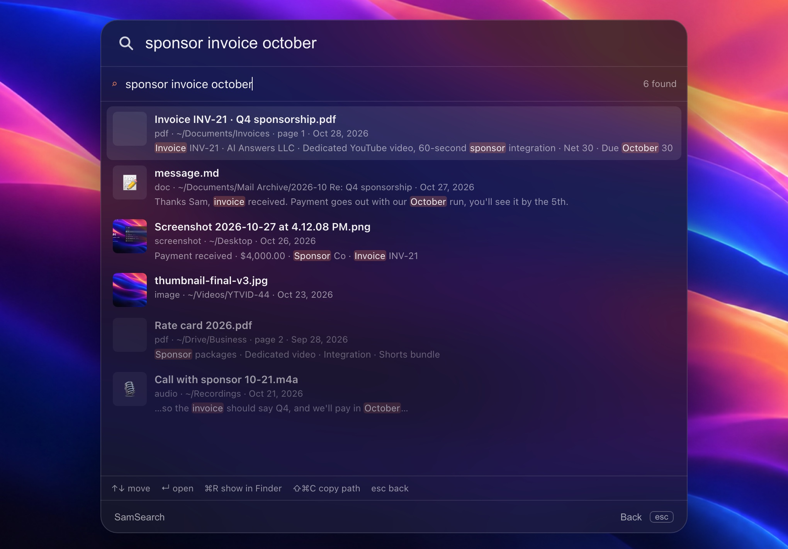
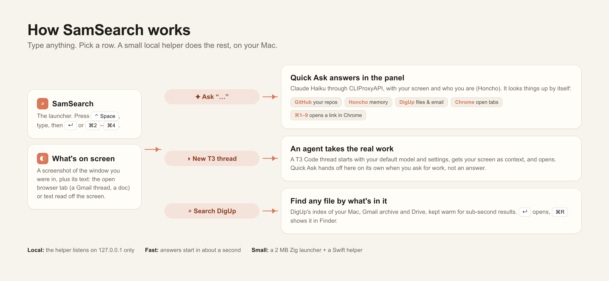

<p align="center">
  
</p>

<h1 align="center">SamSearch</h1>

<p align="center">
  <b>A Mac launcher that sees your screen, knows your stuff, and hands real work to an agent.</b><br>
  Ask about what you're looking at, find any link or file, or start a T3 Code thread, all from one keystroke.<br>
  A fork of <a href="https://github.com/justrach/nanolight">Nanolight</a>: native Zig, about 2 MB, no Electron.
</p>

<p align="center">
  <a href="#-get-started"><b>Get started</b></a> ·
  <a href="#-quick-ask"><b>Quick Ask</b></a> ·
  <a href="#-new-t3-thread"><b>T3 threads</b></a> ·
  <a href="#-digup-search"><b>DigUp</b></a> ·
  <a href="#how-it-works"><b>How it works</b></a>
</p>

<p align="center">
  
  
  
  
  
</p>

<p align="center">
  
</p>

Launchers are good at opening apps and bad at everything after. SamSearch keeps the fast launcher
and adds three rows under whatever you type, always on the same keys: **⌘1 ask** a fast model
that can see your screen, **⌘2 hand the task to an agent** in T3 Code, or **⌘3 find the file** with DigUp.

- **It sees what you see.** A screenshot of the window you were in, plus its real text: the Gmail thread, the doc, the page.
- **It knows you.** Your profile and memory from Honcho, your GitHub repos, your files and email, your open tabs.
- **It finds, then opens.** Ask for a link and get the link. Press **⌘1** and it's open in Chrome.
- **It knows when to stop talking.** Real work ("fix this", "build that") goes straight to a new T3 Code thread.

<table>
<tr>
<td width="33%" valign="top">

### ✦ [Quick Ask](#-quick-ask)
Claude Haiku in the panel · sees your screen and its text · looks things up itself · ⌘1–9 opens links in Chrome · follow-ups

</td>
<td width="33%" valign="top">

### ▸ [New T3 thread](#-new-t3-thread)
One keystroke to an agent · your default model and settings · your screen as context · jumps to the thread

</td>
<td width="33%" valign="top">

### ⌕ [DigUp search](#-digup-search)
Files by what's in them · PDFs, screenshots, recordings · your Gmail archive and Drive · thumbnails in the panel

</td>
</tr>
</table>

## ✦ Quick Ask

Type a question and press **⌘1** (or pick **Ask**). Claude Haiku answers right in the panel, usually starting within a second.

<p align="center"></p>

- **Your screen, as context.** It reads the open tab in Chrome, Arc or Safari (on Gmail, the thread you're in, plus anything you highlighted). In other apps it reads the text off a screenshot.
- **It looks things up.** Your GitHub repos (your account and your orgs), what Honcho remembers about your work, your files and email through DigUp, and your open Chrome tabs.
- **Links, one key away.** Every link in an answer gets a number. **⌘1–⌘9** opens it in Chrome.
- **Keys:** ↵ follow-up · ⌥↵ answer here, no hand-off · ⌘T continue in T3 · ⇧⌘C copy · ⌘↩ pop it out into its own window · esc back to the list.

## ▸ New T3 thread

Press **⌘2** (or pick **New T3 thread**) and SamSearch starts a [T3 Code](https://t3.codes) thread in your project with its default model and settings, with your screen attached as context, then jumps to it. Quick Ask does the same on its own when you ask it for work instead of an answer.

## ⌕ DigUp search

Press **⌘3** (or pick **Search DigUp**) to search your Mac by meaning with DigUp: documents, PDFs, screenshots, images, recordings, and your Gmail and Drive archive. DigUp stays warm in the background, so results land in under a second.

<p align="center"></p>

↑↓ to move · ↵ opens · ⌘R shows it in Finder · ⇧⌘C copies the path.

## ⌁ 2FA codes

Type **2fa**, **otp**, **code**, **codes**, **verification** or **verify** and pick **Find 2FA codes**. Recent codes from both Gmail accounts and Messages appear in the panel, newest first. ↑↓ to move · ↵ or a click copies just the code · ⌘1–⌘9 copies directly. Ask, T3 and DigUp keep their usual ⌘1–⌘3 in the launcher.

It checks the last 30 minutes and refreshes every five seconds for two minutes. **Show last 24h** reaches further back. Gmail uses `~/.local/bin/composio`, with the `aianswer` and `personal` accounts connected. For SMS and iMessage, allow **SamSearch** in **System Settings → Privacy & Security → Full Disk Access**. A source that needs attention says so; the others still work.

## How it works

<p align="center"></p>

SamSearch is the launcher (`src/`, Zig). Its three rows talk to **Quick Ask** (`quickask/`, Swift), a small helper that runs a server on `127.0.0.1:47213`. SamSearch shows the helper's pages right inside its panel, and opens `quickask://` links for hand-offs. The helper answers only its own host name, and its actions need a header other websites can't send.

| Folder | What's inside |
| --- | --- |
| `src/` | The launcher: rows, panel, in-panel pages, Raycast extensions (from Nanolight) |
| `quickask/` | The helper (bundled into the app by `macos/install.sh`): `main.swift` (server, screen context, Haiku and its tools, DigUp, T3), `ask.html`, `digup.html`, `codes.html` |
| `extensions/quick-ask/` | Quick Ask and New T3 Thread as Raycast-style commands |
| `docs/reverse-engineering/` | How the closed Nanolight 0.2.6 binary was taken apart with REA and Rizin before its source turned up |

## 🚀 Get started

You need a Mac with Apple silicon on macOS 14+, [Zig 0.17](https://ziglang.org) and Xcode's command line tools.

```sh
git clone https://github.com/Samin12/samsearch && cd samsearch
sh macos/install.sh
```

One app: the launcher with its Quick Ask helper inside (`Contents/Helpers`), signed with your Apple Development certificate so macOS permissions survive rebuilds, installed to `/Applications` and started. SamSearch starts its helper itself.

Open **SamSearch**, pick the key that opens it, and allow **Quick Ask** in System Settings → Privacy & Security → **Screen Recording**. The first time it reads a browser tab, macOS asks to let it control the browser. Using Nanolight already? Quit it first (they want the same key); SamSearch copies its Raycast extensions and script commands over.

**What Quick Ask talks to** (all on your Mac, all optional except the first):

| | Used for |
| --- | --- |
| [CLIProxyAPI](https://github.com/router-for-me/CLIProxyAPI) on `127.0.0.1:8317` | Claude Haiku. Key from `~/.cli-proxy-api/keys.env` |
| [T3 Code](https://t3.codes) and its `t3` CLI | New threads |
| DigUp | File, email and Drive search |
| [Honcho](https://honcho.dev), key in `~/.honcho/config.json` | Who you are, and memory search |
| [`gh`](https://cli.github.com), signed in | Your repos |

## Everything Nanolight does, still here

- **Finds apps as you type**: whole names, starts of words, initials (`ss` is System Settings), letters in order, and typos (`chorme` is Chrome). What you open often climbs.
- **System Settings panes** (Mac): "login items", "wifi" or "dark mode" lists the pane, under the apps, and Return opens System Settings right at it.
- **Completes inline**: the rest of the top app's name, or of Google's top suggestion, is drawn faintly after the caret. Tab or → takes it; Return never does.
- **Does math**: `2^10 * 3` answers 3,072 (and `0xC00`). Return copies it.
- **Google suggestions**: up to four, under the apps, the words you add in bold. Nothing that reads as an address (a dot, a slash, an @) is sent.
- **Results in the panel**: Return on a search shows Google's page in the panel itself. Esc goes back to the list, ⌘↩ opens it in your browser, ⌘[ goes back a page. Prefer the browser? Turn on **Open Searches in Browser** in Settings: Return opens your browser, and ⌘↩ shows the page in the panel.
- **Ask & Search**: Quick Ask (Haiku with screen context), a new T3 Code thread with default settings, or DigUp for files, screenshots, email and Drive. Quick Ask and DigUp show local helper pages in the panel at `http://127.0.0.1:47213`; ⌘↩ on Quick Ask opens its floating answer window. T3 opens through `quickask://t3-thread-create`. The helper must be running and registered for `quickask://` links.
- **Raycast extensions**: extensions from the [Raycast Store's repository](https://github.com/raycast/extensions) (MIT) run in the panel: their lists, details and forms, their actions on ⌘K. Choose **Install Raycast Extension…** to search the store. They are React and TypeScript, so they need [Node.js](https://nodejs.org) 20 or later on your computer; SamSearch brings none, and runs them through its own version of `@raycast/api` ([raycast/README.md](raycast/README.md)). AI, OAuth and the menu bar aren't supported.
- **Raycast script commands** ([raycast/script-commands](https://github.com/raycast/script-commands), MIT): any script with `@raycast.*` comments, dropped in the Script Commands folder, is a row. SamSearch runs it itself, no Node needed: its arguments as a form, its output as it prints (`fullOutput`), its last line (`compact`), or nothing (`silent`).
- **Settings in the panel**: ⌘, (Ctrl+, on a PC), the gear in the footer, or type "settings".
- **⌘1–⌘9** run a row at once; ↑ ↓ and ⌃N ⌃P move.
- On the Mac it lives in the menu bar: no Dock icon, and nothing drawn while it's idle. **Show in Menu Bar** in Settings hides the icon; Settings stays a ⌘, away in the panel.

## Sync across computers (optional)

Off until you turn it on: choose **Sign In with Codegraff** in Settings (or the menu bar icon's menu on the Mac). Your browser opens codegraff.com to approve the sign-in, and from then on every computer signed in to the same account shares:

- the key that opens SamSearch,
- whether Google suggestions are on,
- how often you open each app, so an empty panel suggests the same apps everywhere.

Two Macs merge rather than overwrite: the key and the suggestions setting follow whichever Mac changed them last, and each app keeps its higher count. Nothing else is sent: no queries, no history, no files. The sign-in key is kept in your Keychain, and **Sign Out of Codegraff** revokes it.

Syncing goes through your Codegraff account, so [Codegraff's terms](https://codegraff.com/terms) and [privacy policy](https://codegraff.com/privacy) apply to it. New accounts made by signing in from SamSearch get $2 of Codegraff credit.

## Build

You need Zig 0.17.1 and Xcode or the Command Line Tools.

```sh
QUICKASK_NO_START=1 QUICKASK_NO_REGISTER=1 QUICKASK_APP=/tmp/SamSearch-Codes/QuickAsk.app sh quickask/build.sh
/tmp/SamSearch-Codes/QuickAsk.app/Contents/MacOS/QuickAsk --selftest-codes
# QUICKASK_PORT=47214 .../QuickAsk --serve-codes runs just the server for a local check.
zig build test      # search, math, suggestions and the panel, through nanoui's Tester
zig build run       # build and open it
zig build app       # zig-out/SamSearch.app, for /Applications
VERSION=0.1.0 sh macos/package.sh   # the Mac release: signed app, disk image, update zip, manifest.json
VERSION=0.1.0 sh pc/package.sh      # Windows' zip and Linux's tarballs, added to manifest.json
zig build -Dtarget=x86_64-windows-gnu   # any target from any machine
cd raycast && npm test              # the Raycast extensions' host
```

`macos/package.sh` signs with `$CODESIGN_IDENTITY` and notarizes when notary credentials are set (see the script); otherwise it signs ad hoc. Pushing a `v*` tag runs `.github/workflows/release.yml`, which builds, signs and attaches the release.

SamSearch keeps its data in `~/Library/Application Support/SamSearch` on macOS. On first run, if that folder is absent, it copies `extensions/` and `script-commands/` from Nanolight's data folder, preserving the originals. Preferences and the Keychain service belong to SamSearch.

## How it's made

| File | What |
| --- | --- |
| `src/main.zig` | The app: the window, the hot key, the menu bar icon, updates |
| `src/view.zig` | The panel: query, rows, footer, keys |
| `src/results.zig` | What a query lists, in order |
| `src/search.zig` | Fuzzy matching and ranking, allocation-free |
| `src/calc.zig` | The calculator |
| `src/suggest.zig` | Google's completions: the privacy guard, decoding, the cache (after [browse](https://github.com/justrach/browse)) |
| `src/preview.zig` | The results page in the panel (WKWebView, the Mac) |
| `src/panel_mac.zig`, `src/panel_pc.zig` | The panel's window on the Mac, and on Windows and Linux |
| `src/hotkey*.zig`, `src/apps_*.zig`, `src/single*.zig`, `src/login.zig`, `src/keychain*.zig` | Each platform's key, apps, single copy, login item and secret |
| `src/raycast*.zig`, `raycast/` | Raycast extensions: the panel's screen, the Node host and its `@raycast/api` |
| `src/script_commands.zig`, `src/script_run.zig` | Raycast script commands, run in Zig |
| `src/onboard.zig`, `src/shortcut.zig`, `src/recorder.zig` | The welcome, which key is free, recording one's own |
| `src/film.zig`, `src/stage.zig`, `tools/film.sh` | The walkthrough, rendered offscreen |
| `src/promo.zig`, `src/promo_scene.zig`, `src/promo_camera.zig`, `tools/promo.sh`, `tools/promo/` | The promo: nanoui's shots, Blender's laptops, the Windows and Linux recordings ([docs/promo.md](docs/promo.md)) |

The icon is drawn by `tools/icon.py`. `src/backdrop.jpg` (the film's cover art) was made with OpenAI's image model.

Forked from [justrach/nanolight](https://github.com/justrach/nanolight), with the original code structure and nanoui renderer.

## License

MIT, as Nanolight is. SamSearch is built on [Nanolight](https://github.com/justrach/nanolight) by justrach; see [LICENSE](LICENSE).
